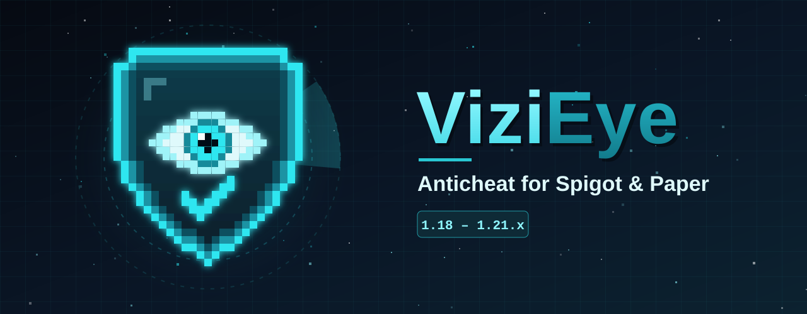

<div align="center">



### An anticheat that catches cheaters - and leaves fair players alone.
Movement, combat, world and inventory checks · anti-xray · staff tools · no dependencies

<br>

[](https://github.com/Jagm3nz/ViziEye/releases/latest)


[](https://github.com/Jagm3nz/ViziEye/releases/latest)
[](https://github.com/Jagm3nz/ViziEye/releases)

</div>

---

## 📚 Contents

- [Features](#-features) · [Checks](#%EF%B8%8F-checks) · [Anti-xray](#%EF%B8%8F-anti-xray-fake-ores) · [Staff tools](#%EF%B8%8F-staff-tools)
- [Installation](#-installation) · [Compatibility](#-compatibility) · [Commands](#%EF%B8%8F-commands) · [Permissions](#-permissions)
- [Tutorials](#-tutorials) · [Configuration](#%EF%B8%8F-configuration) · [How it works](#-how-it-works) · [FAQ](#-faq) · [For developers](#-for-developers)

## ✨ Features

| Feature | What it does |
|---|---|
| 🛡️ **26 checks** | Fly, Speed, KillAura, Reach, Scaffold, Nuker, X-ray, ElytraFly, BoatFly, AutoTotem and many more - see [Checks](#%EF%B8%8F-checks). |
| 🎯 **Blocks, not just alerts** | Every check stops the cheat right away (setback, cancelled hit or placement) - and you can switch that off per check. |
| 🤝 **Fair to real players** | Lag, ping, knockback, explosions, elytras, boats, ladders, water, slime blocks... are all taken into account. |
| 🔬 **Real physics** | Gravity, elytra flight and vehicle speeds are replayed with vanilla's own formulas instead of guessed limits. |
| 📡 **Sees blocked attempts** | Reads the packets the server silently ignores (like hits from 10 blocks away) - no ProtocolLib needed. |
| 💎 **Anti-xray** | Fake ores for x-ray users and ore bots, or works together with Paper's built-in anti-xray. |
| 👁️ **Staff tools** | Alerts in chat, a player menu sorted by violations, invisible spectating, a violation log. |
| ⚖️ **Violation points** | Every flag adds points that slowly fade. Kick, ban or run any command at any number of points. |
| 🌐 **Translatable** | Every message lives in `config.yml` with `&` colors and HEX colors (`&#00FFAA`). |
| 🔐 **Renamable permissions** | Every permission node can be renamed in the config. |
| 📦 **One jar, all versions** | The same file works on every version from 1.18 to 1.21.x. No dependencies. |

## 🛡️ Checks

Every check adds **violation points (VL)** that slowly fade, alerts staff from `alert-vl`, and can run
punishments at any VL. With `block: true` (the default) it also stops the cheat - the right column shows how.

### 🏃 Movement

| Check | Detects | Blocking |
|---|---|---|
| **Fly** | Flying, hovering, jumping higher than possible, falling slower than gravity (glide, slow fall, air jumps) | Back to the ground |
| **Speed** | Moving faster than possible (ice, potions, soul speed counted in), speeding up in mid-air (strafe, bunny hop) | Teleported back |
| **Step** | Stepping up a full block without jumping | Teleported back |
| **Jesus** | Walking on water or lava | Teleported back |
| **NoFall** | Avoiding fall damage | The avoided damage is applied |
| **Timer** | Speeding up the game clock | Teleported back |
| **Spider** | Climbing walls without a ladder, vines or scaffolding | Teleported back |
| **NoClip** | Walking into blocks or through walls | Sent back |
| **ElytraFly** | Elytra flight that real elytra physics can't do - hovering, rising without fireworks, instant turns | Sent back |
| **BoatFly** | Flying boats; flying or jumping too high on horses, camels, pigs and striders | Taken off, both sent back |
| **EntitySpeed** | Riding faster than the animal or boat can go - every horse has its own speed | Taken off, both sent back |
| **NoSlow** | Full speed while eating, drinking, drawing a bow or blocking with a shield | Teleported back |

### ⚔️ Combat

| Check | Detects | Blocking |
|---|---|---|
| **Reach** | Hitting, breaking or using blocks from too far away (ping compensated) - also attempts the server ignores | Hit cancelled |
| **KillAura** | Hits outside the crosshair or through walls, several targets at once, aim faked only for the hit ("snap"), robot-perfect hit timing, hits without swinging | Hit cancelled, hits blocked for 3 s |
| **AutoClicker** | Too many clicks per second, perfectly even clicking | Hits blocked for 1 s |
| **Velocity** | Ignoring knockback | The server pushes the player |
| **AutoTotem** | A new totem faster than a human can react (ping subtracted) | Totem swap cancelled |
| **Criticals** | Critical hits without a real jump | Hit cancelled |

### 🧱 World

| Check | Detects | Blocking |
|---|---|---|
| **FastBreak** | Breaking blocks faster than the tool allows | The block stays |
| **Nuker** | Breaking blocks behind you, out of reach, too many per second | Break cancelled |
| **FastPlace** | Right-clicking blocks faster than anyone can click | Placement cancelled |
| **Scaffold** | Placing on faces you can't see or that are hidden behind blocks, behind you, out of reach, aim faked only for the placement | Placement cancelled |
| **AirPlace** | Placing blocks in mid-air or against water / lava | Placement cancelled |
| **Xray** | Finding rare ores with far too little stone mined | Alert only |

### 🎒 Inventory

| Check | Detects | Blocking |
|---|---|---|
| **InventoryMove** | Clicking in the inventory while walking | Click cancelled |
| **FastClick** | Chest stealers, auto armor | Click cancelled |

Example alert in chat:

```
[ViziEye] Steve failed KillAura (turned 154° to the target just for the hit and straight back (2 times)) VL 1.0
```

## ⛏️ Anti-xray (fake ores)

Every player gets their **own fake ores**, sent only to their client, inside stone that is **completely enclosed**.
A fair player never sees them. With x-ray - or an ore-finding bot like Baritone - ores show up everywhere and the real
ones can't be told apart.

- Fakes near a spot disappear as soon as the player starts digging there, clicks it, or a block nearby is broken,
  blown up or moved by a piston - fair players never run into one.
- Creative / spectator players and players with the bypass permission never get fakes.
- The **Xray** check works on its own as well: it watches how much stone a player digs through per ore vein.

Paper has a built-in anti-xray that can also **hide the real ores** - the strongest option. ViziEye works together with it:

| `anti-xray.mode` | Behaviour |
|---|---|
| `auto` *(default)* | ViziEye's fake ores only in worlds where Paper's anti-xray is off |
| `plugin` | Always ViziEye's fake ores |
| `off` | Disabled |

## 👁️ Staff tools

| Tool | How |
|---|---|
| 🔔 **Alerts** | Staff with the alerts permission see every violation in chat. `/ve alerts` turns them off / on. |
| 📋 **Player menu** | `/ve gui` - a head for every online player, sorted by violations, with each check's points and ping. **Left click** teleports you there, **right click** starts spectating. |
| 🕵️ **Spectate** | `/ve spectate <player>` - spectator mode next to the player, hidden from normal players. `/ve spectate` puts you back exactly where you were, in your old game mode. |
| 🔎 **Info** | `/ve info <player>` - violations, ping and the server TPS. |
| 📝 **Log** | Every violation is saved to `plugins/ViziEye/violations.log`. |

## 📥 Installation

1. Download **`ViziEye-<version>.jar`** from the [**latest release**](https://github.com/Jagm3nz/ViziEye/releases/latest).
2. Put it into your server's `plugins` folder.
3. Restart the server - `plugins/ViziEye/config.yml` is created.
4. Give your staff the alerts permission (see [Tutorials](#-tutorials)) and you're protected.

> [!TIP]
> On a live server, start with `alerts-only: true` for a few days - ViziEye then only alerts staff and never blocks or
> punishes, so you can see how your players are flagged first.

## 🧩 Compatibility

| | Supported |
|---|---|
| **Minecraft** | 1.18 · 1.19 · 1.20 · 1.21 - every sub-version, up to **1.21.11** |
| **Server software** | Spigot, Paper, Purpur and other Spigot forks (Folia is not supported) |
| **Java** | 17 or newer |
| **Dependencies** | None - ProtocolLib / PacketEvents are **not** needed |
| **Older clients** | Works with ViaVersion / ViaBackwards / ViaRewind |

> [!NOTE]
> On **Paper** ViziEye can also report moves the server itself refused (walking through walls).
> On Spigot the server still blocks them - they just aren't reported.

## ⌨️ Commands

| Command | Description | Permission |
|---|---|---|
| `/ve alerts` | Turn your alerts on / off | `vizieye.alerts` |
| `/ve info <player>` | A player's violations, ping and the server TPS | `vizieye.info` |
| `/ve gui` | Menu with all online players, sorted by violations | `vizieye.gui` |
| `/ve spectate [player]` | Spectate a player invisibly / go back | `vizieye.spectate` |
| `/ve reload` | Reload `config.yml` | `vizieye.reload` |

**Alias:** `/vizieye`

## 🔐 Permissions

| Permission | Default | Description |
|---|---|---|
| `vizieye.alerts` | OP | See alerts, `/ve alerts` |
| `vizieye.info` | OP | `/ve info` |
| `vizieye.gui` | OP | `/ve gui` |
| `vizieye.spectate` | OP | `/ve spectate` |
| `vizieye.reload` | OP | `/ve reload` |
| `vizieye.*` | OP | All staff permissions above (**not** bypass) |
| `vizieye.bypass` | **nobody** | The player is never checked - not even OPs have it by default |

> [!TIP]
> Every permission name can be changed in the `permissions` section of the config - e.g. `alerts: "myserver.staff.alerts"`.

## 📖 Tutorials

<details>
<summary><b>1. Your first days with ViziEye</b></summary>

1. Install ViziEye and set `alerts-only: true` in `config.yml`, then `/ve reload`.
2. Give yourself and your staff the alerts permission (next tutorial).
3. Play normally for a few days and watch the alerts. `/ve gui` shows who is flagged the most.
4. If a check flags fair players on your server (custom plugins that launch players, special maps...),
   raise its `alert-vl`, tune its options, or turn its `block` off - see tutorial 5.
5. Set `alerts-only: false` and `/ve reload` - from now on cheats are blocked and punishments run.

</details>

<details>
<summary><b>2. Giving your staff alerts (LuckPerms)</b></summary>

```
/lp group helper permission set vizieye.alerts true
/lp group helper permission set vizieye.info true
/lp group moderator permission set vizieye.* true
```

`vizieye.*` gives every staff permission - but never `vizieye.bypass`, so your staff are still checked.

</details>

<details>
<summary><b>3. Punishments - kicks, bans and your ban plugin</b></summary>

Every check has a `punishments` section: **the number is the VL** at which the actions run.

```yaml
checks:
  killaura:
    punishments:
      15: ["message &cStop using KillAura!"]
      30: ["kick &c[ViziEye] &fUnfair advantage detected &7(KillAura)"]
      50: ["command tempban {player} 7d KillAura (ViziEye)"]
```

| Action | What it does |
|---|---|
| `kick <reason>` | Kicks the player with the reason |
| `command <command>` | Runs a console command - use your ban plugin here |
| `message <text>` | Sends a message to the player |
| `broadcast <text>` | Sends a message to everyone |

Placeholders: `{player}`, `{check}`, `{vl}`, `{info}`. Examples for popular ban plugins:

```yaml
50: ["command ban {player} Cheating ({check})"]                   # vanilla / EssentialsX
50: ["command tempban {player} 7d Cheating ({check})"]            # EssentialsX
50: ["command litebans:tempban {player} 7d Cheating ({check})"]   # LiteBans
```

</details>

<details>
<summary><b>4. Setting up the best anti-xray (Paper)</b></summary>

1. Open `config/paper-world-defaults.yml` and set:

   ```yaml
   anticheat:
     anti-xray:
       enabled: true
       engine-mode: 2
   ```

   Paper's documentation has recommended block lists for the overworld and the Nether.
2. Restart the server. With `anti-xray.mode: auto` (the default) ViziEye notices it and switches its own fake ores off
   in those worlds - the console shows which anti-xray is active in each world.
3. The **Xray** check keeps watching mining statistics either way.

On Spigot (no built-in anti-xray) ViziEye's fake ores are used automatically.

</details>

<details>
<summary><b>5. Tuning a check, or turning it off</b></summary>

Every check has the same basic options:

```yaml
checks:
  fastplace:
    enabled: true     # false = the check is completely off
    block: true       # false = only alerts, the cheat is not stopped
    alert-vl: 2       # staff get alerts from this many violation points
    decay: 1.0        # points that fade away every second
    max-right-clicks-per-second: 15   # check-specific options - explained in the config
```

After editing, run `/ve reload`. New options added in updates are written into your config automatically -
your own values are never overwritten.

</details>

<details>
<summary><b>6. Translating the messages</b></summary>

All texts are in the `messages` section. For example, in Polish:

```yaml
messages:
  prefix: "&8[&bVizi&3Eye&8] &r"
  alert: "&f{player} &7oblał &b{check} &8(&7{info}&8) &7VL &c{vl}"
  alerts-on: "&aAlerty włączone."
  alerts-off: "&cAlerty wyłączone."
  no-permission: "&cNie masz uprawnień do tej komendy."
```

</details>

<details>
<summary><b>7. Plugins that launch or move players</b></summary>

Jump pads, launchers, grappling hooks and minigames can move players in ways a normal player can't. Either give those
players the bypass permission for a moment, or - if you write the plugin - use the
[developer helper](#-for-developers), which does exactly that in one line.

</details>

## ⚙️ Configuration

The most important global options:

| Option | Default | Description |
|---|---|---|
| `alerts-only` | `false` | Only alert staff, never block or punish - great for testing |
| `min-tps` | `15.0` | Movement checks pause while the server lags this badly |
| `max-ping` | `400` | Above this ping only the knockback check is skipped |
| `alert-cooldown-ms` | `1000` | Minimum time between two alerts for the same player and check |
| `log-to-file` | `true` | Save every violation to `violations.log` |
| `join-grace-ticks` | `60` | No checks for 3 seconds after joining / respawning |
| `max-launch-seconds` | `5` | Longest time a launch (explosion, slime, wind charge) pauses the height checks |
| `anti-xray.mode` | `auto` | `auto`, `plugin` or `off` - see [Anti-xray](#%EF%B8%8F-anti-xray-fake-ores) |

<details>
<summary><b>📄 Full default <code>config.yml</code></b></summary>

```yaml
# ==========================================
#          ViziEye - configuration
# ==========================================
# This file is created automatically on the first server start.
# After editing, run: /vizieye reload (or restart the server)
#
# How it works:
#  - Every check adds violation points (VL) when it sees something impossible.
#  - VL slowly goes back down on its own ("decay"), so one lag spike never gets anyone punished.
#  - "block: true" stops the cheat right away (what exactly it does is written next to every check).
#  - Staff with the alerts permission see alerts in chat once a check reaches "alert-vl".
#  - "punishments" run when the VL reaches the given number.
#
# Punishment actions (placeholders: {player} {check} {vl} {info}):
#   "kick <reason>"      - kicks the player with that reason
#   "command <command>"  - runs a console command (e.g. a ban from your ban plugin)
#   "message <text>"     - sends a message to the player
#   "broadcast <text>"   - sends a message to everyone

# ------------------------------------------
#  GENERAL
# ------------------------------------------
settings:
  # true = only alert staff, never block or punish (great for testing on a live server first)
  alerts-only: false
  # Movement checks pause while the server lags this badly (average TPS). All other checks keep running,
  # and short freezes are detected separately.
  min-tps: 15.0
  # Above this ping (ms) only the knockback check (Velocity) is skipped - every other check keeps running,
  # so faking a high ping doesn't switch the anticheat off. 0 = never skip
  max-ping: 400
  # Minimum time between two alerts about the same player and check (ms)
  alert-cooldown-ms: 1000
  # Also print alerts to the server console
  console-alerts: true
  # Save every violation to plugins/ViziEye/violations.log
  log-to-file: true
  # No checks right after joining / respawning, and for a moment after a teleport (ticks, 20 = 1 second)
  join-grace-ticks: 60
  teleport-grace-ticks: 5
  # Being launched (explosions, slime, wind charges, leaving a vehicle...) pauses the height checks until
  # the player lands - but never for longer than this. Gravity is checked the whole time anyway.
  max-launch-seconds: 5

# ------------------------------------------
#  PERMISSIONS
# ------------------------------------------
# You can rename every permission, e.g. alerts: "myserver.anticheat.alerts"
# "bypass" is NOT given to OPs by default - give it only to accounts that should never be checked.
permissions:
  alerts: vizieye.alerts          # see alerts, /vizieye alerts
  info: vizieye.info              # /vizieye info <player>
  reload: vizieye.reload          # /vizieye reload
  gui: vizieye.gui                # /vizieye gui
  spectate: vizieye.spectate      # /vizieye spectate <player>
  bypass: vizieye.bypass          # never checked, never gets fake ores
  all: vizieye.*                  # all staff permissions (not bypass)

# ------------------------------------------
#  SPECTATE (/vizieye spectate <player>)
# ------------------------------------------
spectate:
  # Hide spectating staff from normal players (also from the tab list)
  hide-from-players: true

# ------------------------------------------
#  ANTI-XRAY (fake ores)
# ------------------------------------------
# Every player gets fake ore blocks inside stone that is completely enclosed, sent only to their
# own client - nobody can see them without x-ray. X-ray users and ore bots like Baritone see ores
# everywhere and can't tell which are real. Fakes near a spot disappear as soon as a player starts
# digging or clicks there, and when a block nearby is broken or blown up, so legit players never
# run into one.
#
# Paper has a built-in anti-xray (config/paper-world-defaults.yml -> anticheat.anti-xray) that can
# also HIDE the real ores, which a plugin cannot do reliably. Recommended on Paper: enabled: true,
# engine-mode: 2.
#   auto   - use ViziEye's fake ores only in worlds where Paper's anti-xray is off (default)
#   plugin - always use ViziEye's fake ores
#   off    - disabled
anti-xray:
  mode: auto
  # Fake ores are placed this many blocks around the player
  radius: 16
  max-fakes-per-player: 200
  # How many spots are tried per player every second
  attempts-per-second: 300
  # Fakes within this many blocks of a dig / click disappear
  reveal-radius: 3
  # Highest Y for fake ores in the overworld (the Nether uses its whole height)
  max-y: 64
  # Worlds to protect. Empty = all worlds (except the End)
  worlds: []
  # Fake ores in the overworld (the deepslate version is used automatically deep down)
  ores:
    - DIAMOND_ORE
    - DIAMOND_ORE
    - DIAMOND_ORE
    - GOLD_ORE
    - IRON_ORE
    - REDSTONE_ORE
    - LAPIS_ORE
    - EMERALD_ORE
  nether-ores:
    - ANCIENT_DEBRIS
    - ANCIENT_DEBRIS
    - NETHER_GOLD_ORE
    - NETHER_QUARTZ_ORE

# ------------------------------------------
#  MOVEMENT CHECKS
# ------------------------------------------
# block: true = the player is teleported back to the last safe spot on the ground (setback)
checks:
  fly:
    # Flying, hovering, jumping higher than possible, and falling slower than gravity (glide, slow fall,
    # jumping in mid-air). Every move in the air is compared with vanilla gravity.
    enabled: true
    block: true
    alert-vl: 2
    decay: 1.0
    # How much higher than a normal jump (1.25 blocks + jump boost) a player may get
    height-tolerance: 0.35
    # Extra air moves allowed while still going up
    rise-tolerance: 3
    # How far (blocks per tick) a move may be above what gravity allows
    gravity-tolerance: 0.01
    # In the air for this many ticks without going up, the player must have fallen at least
    # "hover-min-fall" blocks (a real fall covers more than 4 blocks in 20 ticks)
    hover-ticks: 20
    hover-min-fall: 1.0
    punishments:
      40: ["kick &c[ViziEye] &fUnfair advantage detected &7(Fly)"]

  speed:
    # Moving faster than possible (walking, sprint-jumping, ice, speed potions are all counted in)
    enabled: true
    block: true
    alert-vl: 3
    decay: 2.0
    # Highest average distance per tick (sprint-jumping is about 0.36)
    max-speed: 0.42
    # Multipliers for fast surfaces
    ice-multiplier: 2.4
    blue-ice-multiplier: 3.2
    ceiling-multiplier: 1.35
    # In the air a player can speed up only 0.026 blocks/tick per tick - this much more is allowed
    air-tolerance: 0.02
    punishments:
      40: ["kick &c[ViziEye] &fUnfair advantage detected &7(Speed)"]

  step:
    # Stepping up a full block (or more) without jumping
    enabled: true
    block: true
    alert-vl: 1
    decay: 0.5
    tolerance: 0.1
    punishments: {}

  jesus:
    # Walking on water or lava
    enabled: true
    block: true
    alert-vl: 2
    decay: 1.0
    # Moves above the liquid surface before it counts
    min-moves: 10
    punishments: {}

  nofall:
    # Avoiding fall damage
    # block: true = the player gets the fall damage they tried to avoid
    enabled: true
    block: true
    alert-vl: 1
    decay: 0.5
    # Falls shorter than this never deal damage in vanilla (+1 per jump boost level)
    min-fall-distance: 4.0
    # Moves in a row the client may claim to stand on air before it counts
    spoof-buffer: 3
    punishments: {}

  timer:
    # Speeding up the game: more than 20 movement packets per second
    enabled: true
    block: true
    alert-vl: 3
    decay: 1.0
    # How far ahead of real time a player may get (ms). Lag bursts only pay back waiting time.
    max-balance: 250
    max-lag-ms: 1000
    punishments:
      30: ["kick &c[ViziEye] &fUnfair advantage detected &7(Timer)"]

  spider:
    # Climbing up a wall like on a ladder. Ladders, vines, scaffolding, twisting / weeping / cave vines,
    # open trapdoors, water, cobwebs and powder snow are fine - and so is a normal jump next to a wall.
    enabled: true
    block: true
    alert-vl: 2
    decay: 1.0
    # How much higher / longer than a jump the player may go up along a wall
    height-tolerance: 0.1
    tolerance-moves: 1
    punishments:
      30: ["kick &c[ViziEye] &fUnfair advantage detected &7(Spider)"]

  noclip:
    # Walking into blocks or through walls (phase). The server itself already sends such players back;
    # on Paper ViziEye also reports each time it had to. Players stuck in a block can always get out.
    # block: true = the player is sent back to where they were before the move
    enabled: true
    block: true
    alert-vl: 3
    decay: 0.5
    punishments:
      20: ["kick &c[ViziEye] &fUnfair advantage detected &7(NoClip)"]

  elytrafly:
    # Flying with an elytra in a way a real elytra can't: hovering, going up without fireworks,
    # turning or speeding up instantly. ViziEye replays vanilla's elytra physics for every move.
    # Fireworks, riptide, knockback, wind charges, slow falling and flying close to blocks are fine.
    # block: true = the player is sent back to where the flight stopped looking normal
    enabled: true
    block: true
    alert-vl: 2
    decay: 1.0
    # How far (blocks) the player may drift away from the normal elytra path
    max-offset: 0.5
    # Fastest possible elytra dive in blocks per tick (vanilla tops out at about 3.9)
    max-speed: 4.2
    # Real gliding can't stay slower than 0.1 blocks/tick for more than about half a second
    hover-ticks: 60
    punishments:
      30: ["kick &c[ViziEye] &fUnfair advantage detected &7(ElytraFly)"]

  boatfly:
    # Flying with a boat, and flying / jumping too high with a horse, camel, pig or strider.
    # Every animal may jump as high as its own jump strength allows. Water, bubble columns, slime,
    # ladders, pistons, levitation and slow falling are fine.
    # block: true = the player is taken off the vehicle and both are sent back to the last safe spot
    enabled: true
    block: true
    alert-vl: 2
    decay: 1.0
    height-tolerance: 0.5
    hover-moves: 8
    punishments:
      30: ["kick &c[ViziEye] &fUnfair advantage detected &7(BoatFly)"]

  entityspeed:
    # Riding faster than the vehicle can go. Every horse has its own speed, so the limit is read from
    # the animal itself (potions on it included). Boats get the top speed of the surface below them:
    # about 8 blocks/s on water, 40 on ice, 72 on blue ice.
    # block: true = the player is taken off the vehicle and both are sent back to the last safe spot
    enabled: true
    block: true
    alert-vl: 3
    decay: 1.0
    # Extra room on top of the vanilla top speed (1.1 = 10%)
    tolerance: 1.1
    punishments:
      40: ["kick &c[ViziEye] &fUnfair advantage detected &7(EntitySpeed)"]

  noslow:
    # Walking at full speed while eating, drinking, drawing a bow / crossbow or blocking with a shield -
    # all of these slow the player down to a fifth of the walking speed.
    enabled: true
    block: true
    alert-vl: 2
    decay: 1.0
    # Highest speed (blocks per tick) on the ground while using an item (vanilla is about 0.05)
    max-speed: 0.1
    # Ticks after starting to use an item before checking (momentum, ping)
    start-ticks: 6
    # Moves in a row over the limit before a flag
    moves: 5
    punishments: {}

# ------------------------------------------
#  COMBAT CHECKS
# ------------------------------------------
# block: true = the suspicious hit is cancelled (no damage, no knockback)

  reach:
    # Hitting, breaking or using blocks from too far away.
    # The server itself ignores hits from further than reach + 1 block (and blocks further than
    # block reach + 1) without telling plugins - ViziEye reads those attempts from the packets and
    # reports them too, so Reach cheats set to 6 - 10 blocks are caught even though they never land a hit.
    enabled: true
    block: true
    alert-vl: 2
    decay: 1.0
    # Vanilla reach is 3.0 blocks (or the entity_interaction_range attribute) - the rest is room for lag
    max-reach: 3.4
    # Attempts the server blocked are reported when they are this much past the server's own limit
    blocked-margin: 1.0
    # Extra reach per millisecond of ping (100 ms -> +0.1), capped at max-ping-bonus. Kept small:
    # moving targets are already measured where the attacker saw them, and a faked ping must not buy reach
    ping-factor: 0.001
    max-ping-bonus: 0.3
    punishments:
      25: ["kick &c[ViziEye] &fUnfair advantage detected &7(Reach)"]

  killaura:
    # Hitting targets you are not looking at, through walls or several at once, turning the view to the
    # target only for the hit and straight back ("snap" - how auras fake their aim), hits always exactly
    # the same number of ticks apart, and hits without swinging the arm.
    # block: true = the hit is cancelled and the player's hits are blocked for "block-seconds"
    enabled: true
    block: true
    alert-vl: 2
    decay: 1.0
    max-angle: 50.0
    check-walls: true
    block-seconds: 3.0
    # A hit after turning at least this much (degrees), when the view jumps back within 4 ticks, is a snap
    snap-angle: 35.0
    # Snaps within 30 seconds before a flag
    snaps: 2
    # This many hits waiting for the attack cooldown, all with (almost) the same gap, are flagged.
    # A human's gaps vary by a few ticks; "min-timing-deviation" is in ticks.
    timing-hits: 9
    min-timing-deviation: 0.7
    # Every real client swings the arm when it attacks
    check-swing: true
    punishments:
      30: ["kick &c[ViziEye] &fUnfair advantage detected &7(KillAura)"]

  autoclicker:
    # Clicking faster or more evenly than a human can
    # block: true = the player's hits are cancelled for a moment after detection
    enabled: true
    block: true
    alert-vl: 3
    decay: 1.0
    max-cps: 22
    # Humans never click with perfectly equal gaps - lower = stricter (ms)
    min-deviation: 4.0
    punishments: {}

  velocity:
    # Ignoring knockback (AntiKnockback / Velocity cheats)
    # block: true = the server pushes the player as far as the knockback should have
    enabled: true
    block: true
    alert-vl: 2
    decay: 0.5
    # Part of the knockback that must show up in the player's movement (0.5 = half)
    min-horizontal: 0.5
    min-vertical: 0.4
    punishments: {}

  autototem:
    # A new totem in the off hand faster than a human can react after one popped.
    # The player's ping is taken off first, so lag never counts.
    # block: true = that totem swap is cancelled
    enabled: true
    block: true
    alert-vl: 2
    # Slow decay - totems pop rarely, so the evidence has to add up over a fight
    decay: 0.05
    # Fastest human reaction (ms). Legit players need well over 150 ms.
    min-reaction-ms: 100
    punishments: {}

  criticals:
    # Critical hits without a real jump: tiny fake hops, or claiming to be in the air while standing.
    # block: true = the hit is cancelled
    enabled: true
    block: true
    alert-vl: 2
    decay: 0.5
    # A critical hit needs a jump / fall of at least this many blocks (a jump goes 1.25 up)
    min-jump: 0.2
    punishments: {}

# ------------------------------------------
#  WORLD CHECKS
# ------------------------------------------
# block: true = the block break / placement is cancelled

  fastbreak:
    # Breaking blocks faster than your tool allows (efficiency, haste etc. are counted in).
    # The server accepts a block after 70% of its time - FastBreak cheats use exactly that - so ViziEye
    # also watches for "finished breaking" sent again and again for one block, and adds up the time
    # saved block after block.
    enabled: true
    block: true
    alert-vl: 2
    decay: 0.5
    # One block in less than this part of its breaking time is flagged at once (0.6 = 60%)
    single-block-ratio: 0.6
    # Normal lag per block (ms) that never counts
    jitter-ms: 50
    # Time saved over several blocks (ms) before a flag
    max-saved-ms: 600
    punishments: {}

  nuker:
    # Breaking blocks too far away, behind you, or too many at once
    enabled: true
    block: true
    alert-vl: 2
    decay: 1.0
    # Survival reach is 4.5 blocks (measured to the nearest point of the block)
    max-distance: 5.0
    max-angle: 75.0
    max-per-second: 24
    punishments:
      20: ["kick &c[ViziEye] &fUnfair advantage detected &7(Nuker)"]

  fastplace:
    # Placing blocks faster than the game allows. Holding right click uses a block every 4 ticks
    # (5 per second); FastPlace cheats right-click every tick (20 per second), placing or not.
    # Clicking by hand, players reach about 10 - 14 per second.
    # block: true = the right clicks / placements over the limit are cancelled
    enabled: true
    block: true
    alert-vl: 2
    decay: 1.0
    # Block placements per second
    max-per-second: 18
    # Right clicks on blocks per second (placing or not)
    max-right-clicks-per-second: 15
    punishments: {}

  scaffold:
    # Auto-bridging: placing on faces you cannot see, behind other blocks or behind you, too far away,
    # and turning the view to the block only for the placement and straight back ("snap").
    # block: true = the placement is cancelled (after snaps: all placements for "block-seconds")
    enabled: true
    block: true
    alert-vl: 2
    decay: 1.0
    max-angle: 100.0
    # Survival reach is 4.5 blocks (measured to the nearest point of the clicked block)
    max-distance: 5.0
    # The clicked face must be visible - not completely behind other solid blocks
    check-line-of-sight: true
    snap-angle: 45.0
    snaps: 3
    block-seconds: 3.0
    punishments:
      25: ["kick &c[ViziEye] &fUnfair advantage detected &7(Scaffold)"]

  airplace:
    # Placing a block in mid-air or against water / lava. A real client can only click existing blocks -
    # its aim goes through air and liquids - but the server places a block wherever a client says it
    # clicked. Lily pads and frogspawn are fine.
    # block: true = the placement is cancelled
    enabled: true
    block: true
    alert-vl: 1
    decay: 0.5
    punishments:
      20: ["kick &c[ViziEye] &fUnfair advantage detected &7(AirPlace)"]

  xray:
    # Mining statistics: too many rare ore veins for the amount of stone mined.
    # Nothing to block here - staff get an alert and can watch the player (/vizieye spectate).
    enabled: true
    block: false
    alert-vl: 1
    # Very slow decay - evidence of x-ray builds up over a long time
    decay: 0.01
    window-minutes: 15
    # At least this many veins before anything is reported
    min-veins: 3
    # Legit players dig through much more stone per vein than this
    max-stone-per-vein: 40
    ores:
      - DIAMOND_ORE
      - DEEPSLATE_DIAMOND_ORE
      - ANCIENT_DEBRIS
      - EMERALD_ORE
      - DEEPSLATE_EMERALD_ORE
    punishments: {}

# ------------------------------------------
#  INVENTORY CHECKS
# ------------------------------------------
# block: true = the inventory click is cancelled

  inventorymove:
    # Walking with an inventory open (the game stops you while a screen is open)
    enabled: true
    block: true
    alert-vl: 2
    decay: 1.0
    # Speed on the ground (blocks per tick) that still counts as "standing"
    max-speed: 0.2
    punishments: {}

  fastclick:
    # Clicking inventory slots faster than a human (ChestStealer), putting on armor instantly (AutoArmor)
    enabled: true
    block: true
    alert-vl: 2
    decay: 1.0
    max-clicks-per-second: 20
    # More than this many armor pieces within armor-window-ms = AutoArmor
    max-armor-pieces: 2
    armor-window-ms: 250
    punishments: {}

# ------------------------------------------
#  MESSAGES
# ------------------------------------------
# Colors: &a, &l etc. and HEX: &#00FFAA. Empty message ("") = send nothing.
messages:
  prefix: "&8[&bVizi&3Eye&8] &r"
  alert: "&f{player} &7failed &b{check} &8(&7{info}&8) &7VL &c{vl}"
  alerts-on: "&aAlerts enabled."
  alerts-off: "&cAlerts disabled."
  info-header: "&7Violations of &f{player} &8(&7ping {ping} ms, TPS {tps}&8)"
  info-line: "&8 - &b{check}&7: &c{vl}"
  info-none: "&aNo violations."
  unknown-player: "&cPlayer &f{player} &cis not online."
  no-permission: "&cYou don't have permission to use this command."
  player-only: "&cThis command can only be used by players."
  reloaded: "&aConfiguration reloaded."
  usage: "&7Usage: &f/vizieye alerts &7| &finfo <player> &7| &fgui &7| &fspectate [player] &7| &freload"
  spectate-start: "&7Spectating &f{player}&7. Use &f/vizieye spectate &7to go back."
  spectate-stop: "&aBack where you were."
  spectate-self: "&cYou can't spectate yourself."
  gui-title: "&8ViziEye &7- players"
  gui-name: "&f{player}"
  gui-total: "&7Total VL: &c{vl}"
  gui-check: "&8 - &b{check}&7: &c{vl}"
  gui-clean: "&aNo violations"
  gui-ping: "&7Ping: &f{ping} ms"
  gui-left: "&eLeft click &7- teleport"
  gui-right: "&eRight click &7- spectate"
```

</details>

## 🔬 How it works

- **Server-side ground check** - ViziEye checks real block shapes instead of trusting what the client says.
- **Real physics** - every move in the air is compared with vanilla gravity; elytra flight is replayed tick by tick
  with vanilla's own formula; vehicles get the top speed of their own animal or of the surface below the boat.
- **Packet reader** - the server silently ignores hits and block clicks from too far away and never tells plugins.
  ViziEye reads those packets straight from the connection and still reports them. It works on every version and
  switches itself off (with a message in the console) if a server doesn't match, while all other checks keep working.
- **Rotation snaps** - aura and scaffold cheats turn the view to the target for exactly one packet and straight back.
  ViziEye watches for that pattern.
- **Violation points** - one strange move never punishes anyone. Points add up, fade over time, and punishments only
  run at the numbers you choose.
- **Fair-play protection** - knockback, explosions, teleports, respawns, vehicles, elytras, riptide, wind charges,
  levitation, slow falling, slime and bed bounces, water, ladders, cobwebs, bubble columns, lag spikes and high ping are
  all taken into account. Only damage that really pushes a player counts - fire or poison can't be abused for free movement.

## ❓ FAQ

<details>
<summary><b>Do I need ProtocolLib or PacketEvents?</b></summary>

No. ViziEye has no dependencies at all - just drop the jar into `plugins`.
</details>

<details>
<summary><b>Will it punish my fair players?</b></summary>

ViziEye was built to leave fair players alone: every check takes lag, knockback and special blocks into account, and
punishments only run after many violation points. The checks were tested with a fair player doing the same things
a cheater does (ladders, elytras, horses, slime blocks, fast clicking...). Still, start with `alerts-only: true` for a
few days on a live server and read the alerts before you let it punish.
</details>

<details>
<summary><b>Are OPs checked?</b></summary>

Yes. Only players with `vizieye.bypass` are skipped, and not even OPs have it by default.
Players in creative or spectator mode, and players allowed to fly who are flying, are not checked.
</details>

<details>
<summary><b>A check flags a fair player - what now?</b></summary>

Look at the alert text or `plugins/ViziEye/violations.log` - it says exactly what was seen (for example
`Speed: 16.4 blocks/s, max 9.5`). Tune that check's options, raise its `alert-vl`, or set `block: false`.
If you think it's a bug, [open an issue](https://github.com/Jagm3nz/ViziEye/issues) with the log line.
</details>

<details>
<summary><b>What about players with high ping or a laggy server?</b></summary>

Reach and knockback are ping compensated, bursts of delayed packets get their own allowance, and short server
freezes are detected so click and placement rates don't look inflated. Movement checks pause while the TPS is below
`min-tps`. A high (or faked) ping only skips the knockback check - it never switches the anticheat off.
</details>

<details>
<summary><b>Paper's anti-xray or ViziEye's fake ores?</b></summary>

Paper's anti-xray (engine-mode 2) can hide the real ores, which a plugin can't do reliably - use it on Paper.
ViziEye steps aside automatically in those worlds (`anti-xray.mode: auto`) and keeps its Xray statistics check running.
On Spigot, ViziEye's fake ores are used.
</details>

<details>
<summary><b>Does it work with ViaVersion and older clients?</b></summary>

Yes. ViziEye works with ViaVersion, ViaBackwards and ViaRewind - including 1.8 clients, which swing their arm before
attacking instead of after.
</details>

<details>
<summary><b>Does it slow down my server?</b></summary>

No. ViziEye works on the server's own events, keeps only a few numbers per player, and handles packets once per tick
with a limit per player - a client flooding packets can't make it lag the server.
</details>

<details>
<summary><b>Bedrock players (Geyser)?</b></summary>

Bedrock movement differs from Java. If Bedrock players get flagged, give them the bypass permission
(for example through Floodgate's group) or turn off the checks that bother them.
</details>

## 🔌 For developers

Does your plugin launch players (jump pads, grappling hooks, custom knockback)? No API dependency needed -
copy [`integration/ViziEyeHook.java`](integration/ViziEyeHook.java) into your project:

```java
player.setVelocity(new Vector(0, 2.5, 0));   // your launch pad
ViziEyeHook.exempt(this, player, 60);        // ViziEye ignores the player for 3 seconds
```

`exempt` returns `false` when ViziEye is not installed, so your plugin keeps working without it.
Add `softdepend: [ViziEye]` to your `plugin.yml` so ViziEye loads before your plugin.

## 🐞 Support

Found a bug, a false alarm or a cheat that isn't caught? [Open an issue](https://github.com/Jagm3nz/ViziEye/issues) -
please include your server version (`/version`), the alert or `violations.log` line and any errors from the console.

## 📜 License

ViziEye is **free to use** on any server, including commercial ones. Redistribution and re-uploading are not allowed -
see [LICENSE](LICENSE.md).

<div align="center">
<br>
<sub>Made with 💙 by <a href="https://github.com/Jagm3nz">Jagm3nz</a></sub>
</div>
